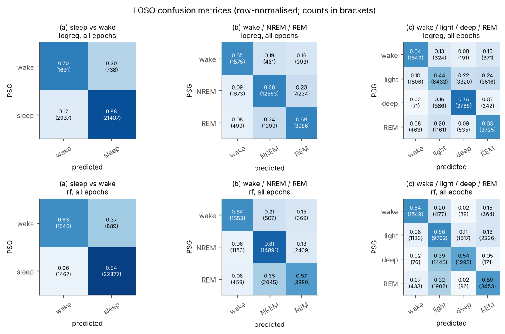
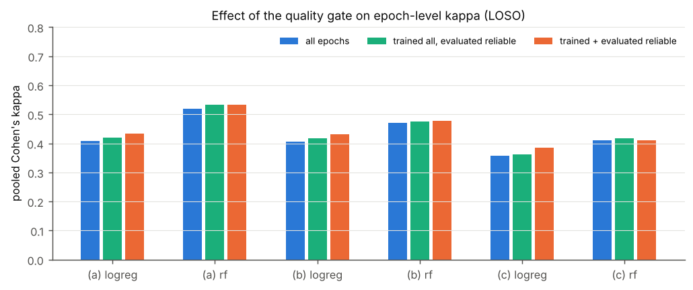
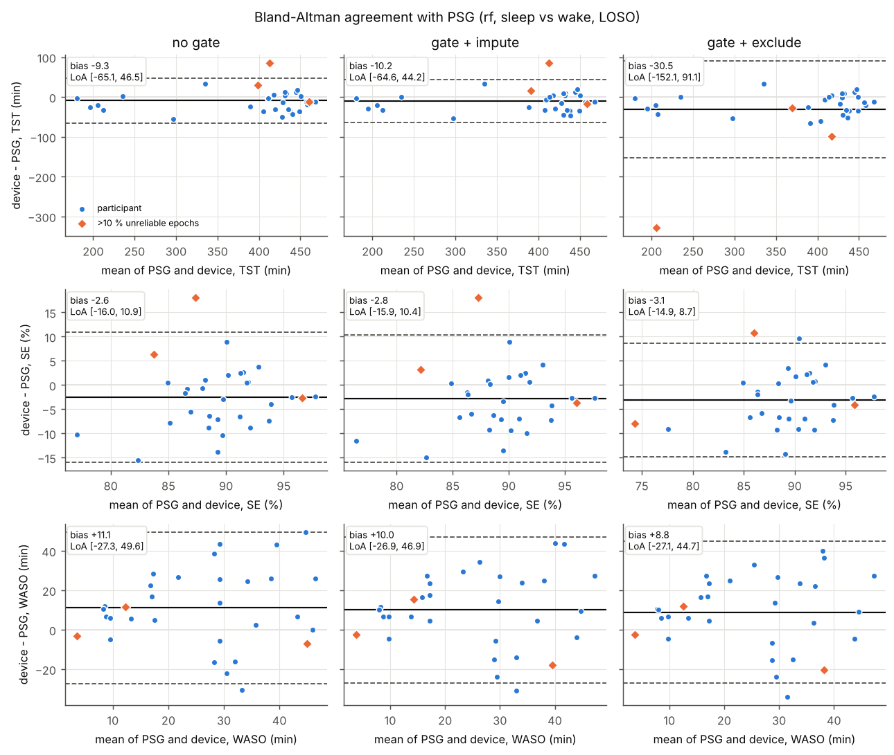
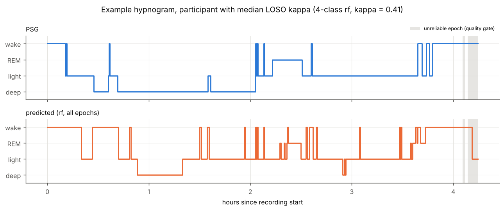

# wrist-sleep-staging

Sleep staging from wrist heart rate and motion, validated against polysomnography (PSG), with an
epoch-level **data-quality gate**. A small, tested Python package (`sleepstage`) and a single
reproducible script that runs leave-one-subject-out (LOSO) evaluation on the public
PhysioNet *sleep-accel* dataset (Apple Watch + PSG, Walch et al., 2019).

> Status: research code for a portfolio / methods exploration. Not a medical device, not validated
> for clinical use.

## Motivation

Consumer wrist devices estimate sleep stages from two signals: motion (accelerometer) and heart
rate from photoplethysmography (PPG). Their algorithms are rarely disclosed, and their outputs
are usually reported without any statement about **how good the underlying signal was** on a
given night or in a given 30 s epoch. In unsupervised home use (e.g. long-term monitoring in
insomnia or sleep-apnoea cohorts), loose straps, the watch being taken off, battery or
transmission gaps and optical tracking errors are common. A model that is forced to output a stage
for every epoch hides these problems inside its sleep estimates.

This repository therefore asks two questions on an open dataset:

1. How well do simple, transparent models (logistic regression, random forest) on wearable-only
   features reproduce PSG staging at increasing granularity: sleep/wake; wake/NREM/REM; and
   wake/light/deep/REM?
2. What changes when epochs with unreliable input data are **flagged instead of forced into a
   stage**? Two things are measured: epoch-level agreement, and night-level estimates (total sleep
   time, sleep efficiency, WASO) when flagged epochs are imputed or excluded.

## Dataset (verified on the PhysioNet page, 2026-11-01)

| Item | Verified value |
|---|---|
| Title | *Motion and heart rate from a wrist-worn wearable and labeled sleep from polysomnography* |
| Version | 1.0.0 (published 8 Oct 2019; only version listed) |
| DOI | [10.13026/hmhs-py35](https://doi.org/10.13026/hmhs-py35) |
| Access | **Open Access** (no credentialing) |
| Licence | **Open Data Commons Attribution License v1.0 (ODC-By 1.0)** |
| Participants | 31 (39 recruited at the University of Michigan; 4 excluded for data-transmission errors, 3 for sleep apnoea, 1 for REM sleep behaviour disorder) |
| Device | Apple Watch: raw acceleration (g) and heart rate (bpm, from PPG); one in-lab PSG night per participant |
| Files | `motion/<id>_acceleration.txt` (`t x y z`, space-separated), `heart_rate/<id>_heartrate.txt` (`t,hr`, comma-separated), `labels/<id>_labeled_sleep.txt` (`t stage`), plus `steps/` (not used). `t` = seconds since PSG start |
| Label coding (documented) | 0 wake, 1 N1, 2 N2, 3 N3, 5 REM; 30 s epochs |

What I found in the files (`scripts/download_data.py` checks every file against the published
`SHA256SUMS.txt`):

* **Undocumented codes.** Two label codes occur that the page does not describe. `-1` (438 epochs)
  is treated as *unscored*. `4` occurs in 356 epochs from three participants and is treated as
  **N3**: stage 4 of the older Rechtschaffen & Kales scheme is merged into N3 under AASM rules.
  This is an assumption; please review.
* **Data outside the scored window.** HR and motion files also contain data from before the PSG
  night (negative `t`, up to several days). Everything outside the scored window is discarded.
* **Sampling.** Accelerometer rates are about 50 Hz for most participants, but 10, 33 and
  66 Hz for some. Some motion files contain short backwards timestamp jumps; these are sorted and
  de-duplicated. HR arrives about every 5 s (median per-participant interval).
* **Shorter scored windows than the paper.** 26,773 scored epochs are analysed. The scored
  window lasts 208–490 min (mean 432 min). The page notes that recordings were cropped where the
  watch battery failed, which matches this. The paper's Table 1 reports TIB 472.6 ± 27.0 min
  (range 373–490). The files therefore do not reproduce that table exactly.
* **One participant with mostly missing data.** In 7749105, HR is only sampled every few minutes
  and the accelerometer stops about 7 h before the end of the PSG. 87.5 % of their epochs fail the
  quality gate. They are kept on purpose, because they are a realistic test case for the gate.

**Licence note.** The data are © their authors and used under ODC-By 1.0. **No data files are
included in this repository**: `data/` is git-ignored, and `results/` contains only aggregated
tables, per-participant summary rows and figures. If you use the data, cite the dataset, the
original paper and PhysioNet (see References).

## Methods

All code is in `src/sleepstage/`; every choice below is also documented in the module docstrings.

**Epoch alignment (`io.py`).** The 30 s epoch grid comes from the PSG label file: epoch *k* is the
half-open interval `[t_k, t_k + 30 s)`. Each sensor sample is assigned to the epoch that contains
its timestamp. The epoch HR is the mean of the HR samples inside the epoch. If an epoch has no HR
sample, its HR is linearly interpolated in time at the epoch midpoint, and the quality gate flags
the epoch. Unscored epochs (`-1`) stay on the grid, so rolling windows see continuous time, but
they are never used for training, evaluation or the PSG reference.

**Features (`features.py`), wearable signals only.** There are 21 features per epoch:

* *Motion*, computed from the vector magnitude `r` of the raw acceleration. All three metrics are
  means over samples, so they do not depend on the sampling rate:
  * ENMO: mean of `max(r − 1 g, 0)`.
  * MAD: mean amplitude deviation, `mean |r − mean r|`.
  * Arm-angle change: mean absolute change of the 5 s-averaged z-angle (van Hees et al. 2013;
    2015).

  The te Lindert & Van Someren activity-count conversion used by Walch et al. is *not* reproduced.
* *Heart rate*:
  * Epoch HR level.
  * Within-epoch SD of the HR samples. This is a crude variability measure; beat-to-beat HRV is
    not available from this device output.
* *Normalisation*. Motion features and HR SD are log-transformed. Then every feature is robust-z-
  scored per night (median/IQR), using only epochs with observed data.
* *Context*. For each base feature: a centred ±5 min rolling mean and SD (21 epochs) and a
  centred ±15 min rolling mean (61 epochs). A causal variant is implemented and tested, but not
  used in the main run.
* *Time*. `hours` since the start of the recording. **Caveat:** the recording here starts at
  the start of PSG scoring, which in this lab protocol is close to lights-off. A wearable would
  only know a user-set or auto-detected start time, so this feature is optimistic. No PSG
  lights-off/on markers are used (the dataset has none). An ablation without it is reported.
* Normalisation and centred windows use the whole night. This is an *offline* ("after waking
  up") analysis, as consumer apps report it, not a real-time stager.

**Quality gate (`quality.py`).** An epoch is *unreliable* if any of these flags is set:

| Flag | Rule (default) |
|---|---|
| `hr_sparse` | < 2 HR samples in the 30 s epoch (nominal is about 6) |
| `hr_implausible` | any HR sample outside 30–200 bpm |
| `hr_jump` | change > 30 bpm between consecutive HR samples ≤ 10 s apart |
| `acc_gap` | < 50 % of the expected accelerometer samples (from the night's median rate) |

Because the Apple Watch reports *processed* HR, not the PPG waveform, true PPG signal quality
(perfusion index, waveform template matching, motion-artefact detection on the raw signal) cannot
be assessed here. The gate only sees the symptoms that reach the HR stream.

**Models (`models.py`).**
* Logistic regression: standardised features, `class_weight="balanced"`.
* Random forest: 300 trees, `min_samples_leaf=20`, `class_weight="balanced_subsample"`.

Gradient boosting was left out: with 31 participants it adds tuning choices that cannot be
validated well. Predictions use the default arg-max decision rule; no threshold tuning.

**Evaluation (`evaluate.py`).** All results are LOSO: 31 folds, each training on 30 participants
and predicting the held-out one. Metrics:
* *Epoch level*:
  * Cohen's κ, both pooled over all held-out epochs and as the mean ± SD of per-participant κ.
  * Accuracy and per-class sensitivity.
  * Wake specificity, in the actigraphy convention: the fraction of PSG-wake epochs scored as
    wake.
* *Night level* (sleep vs wake): TST, SE and WASO. WASO counts wake from the first to the last
  sleep epoch, with no persistent-sleep rule. Agreement with PSG is reported as Bland–Altman
  bias and 95 % limits of agreement (LoA).

**Quality-gate comparison.** Three epoch-level scenarios:
1. `all_epochs`: train and evaluate on all scored epochs.
2. `reliable_eval_only`: the same predictions, evaluated on reliable epochs only.
3. `gated`: train *and* evaluate on reliable epochs only.

At night level, the PSG reference always uses all scored epochs, and the device uses one of three
strategies:
1. `no_gate`: predict every epoch.
2. `impute`: an unreliable epoch takes the prediction of the nearest reliable epoch in time.
3. `exclude`: unreliable epochs are dropped, so TST counts only reliable sleep epochs and SE uses
   only reliable epochs as its denominator.

## Results (from `python scripts/run_all.py`, full dataset, 31 participants)

### Data quality

5.5 % of the 26,773 scored epochs are flagged unreliable:
* 5.0 % accelerometer gaps.
* 3.6 % sparse HR. The two kinds of gap overlap mainly in participant 7749105. In the other
  nights, most accelerometer gaps (436 of 517 epochs) occur while HR is still being recorded.
* 0.3 % HR jumps.
* 0 % implausible HR values.

The gate is concentrated in a few nights. 7749105 has 87.5 % unreliable epochs, and 1066528 and
2598705 each have about 18 %. Most nights are below 2 %. Unreliable epochs are **enriched for
wake**: 20.5 % of unreliable vs 8.4 % of reliable epochs are PSG-wake
(`results/quality_stage_composition.csv`). Gaps happen when people move, take the watch off or
are awake, so excluding epochs is not neutral with respect to sleep stage.

### Epoch-level agreement (LOSO, all scored epochs, no gate)

| Task | Model | κ pooled | κ per participant, mean (SD) | Accuracy | Wake spec. | Other sensitivities |
|---|---|---|---|---|---|---|
| (a) sleep / wake | logreg | 0.409 | 0.405 (0.179) | 0.863 | 0.696 | sleep 0.879 |
| (a) sleep / wake | **rf** | **0.518** | 0.512 (0.155) | 0.912 | 0.634 | sleep 0.940 |
| (b) wake / NREM / REM | logreg | 0.407 | 0.401 (0.176) | 0.677 | 0.648 | NREM 0.680, REM 0.677 |
| (b) wake / NREM / REM | **rf** | **0.470** | 0.454 (0.170) | 0.740 | 0.639 | NREM 0.807, REM 0.574 |
| (c) wake / light / deep / REM | logreg | 0.356 | 0.348 (0.128) | 0.541 | 0.635 | light 0.435, deep 0.756, REM 0.633 |
| (c) wake / light / deep / REM | **rf** | **0.411** | 0.405 (0.157) | 0.624 | 0.638 | light 0.657, deep 0.541, REM 0.587 |

Per-participant κ varies widely. For example, the sleep/wake RF ranges from 0.21 to 0.77
(`results/per_participant_kappa.csv`).



### Effect of the quality gate on κ (pooled κ; 5.5 % of epochs excluded)

| Task | Model | All epochs | Trained all, evaluated reliable | Gated (trained + evaluated reliable) | Δκ gated |
|---|---|---|---|---|---|
| (a) | logreg | 0.409 | 0.420 | 0.433 | +0.024 |
| (a) | rf | 0.518 | 0.533 | 0.533 | +0.015 |
| (b) | logreg | 0.407 | 0.417 | 0.431 | +0.024 |
| (b) | rf | 0.470 | 0.476 | 0.477 | +0.008 |
| (c) | logreg | 0.356 | 0.362 | 0.384 | +0.028 |
| (c) | rf | 0.411 | 0.418 | 0.411 | −0.000 |

Gating gives a small, consistent gain for logistic regression (+0.02 to +0.03). The gain for the
random forest is smaller (0 to +0.015), which suggests the forest is already fairly robust to the
interpolated inputs. For logistic regression, about half of the gain comes from *evaluating* on reliable
epochs, i.e. removing hard epochs. The other half comes from retraining on clean epochs. For the
random forest, all of the gain comes from the evaluation subset. Wake specificity
rises under gating (RF sleep/wake: 0.634 → 0.677). Given the wake enrichment above, this partly
reflects *which* wake epochs remain, so the gain should not be read as a pure accuracy
improvement.



### Night-level agreement (sleep vs wake, RF; device − PSG, minutes or %)

| Metric | No gate: bias [95 % LoA] | Gate + impute | Gate + exclude |
|---|---|---|---|
| TST (min) | −9.3 [−65.1, 46.5] | −10.2 [−64.6, 44.2] | −30.5 [−152.1, 91.1] |
| SE (%) | −2.6 [−16.0, 10.9] | −2.8 [−15.9, 10.4] | −3.1 [−14.9, 8.7] |
| WASO (min) | +11.1 [−27.3, 49.6] | +10.0 [−26.9, 46.9] | +8.8 [−27.1, 44.7] |

These results come from `results/night_level_agreement.csv`, which also covers logistic regression
and a sensitivity analysis without the 7749105 night. Logistic regression is clearly worse at
night level, with TST bias −35.5 min and WASO +32.2 min without the gate.

* **Exclusion breaks TST.** Dropping unreliable epochs makes TST an *undercount*. For 7749105 it
  falls by about 330 min, because the device "sees" only 12 % of the night. Even without that night (30 nights with
  ≤ 50 % unreliable epochs), exclusion shifts the TST bias from −12.5 min [LoA −57.1, 32.1]
  with no gate to −20.6 min [−76.7, 35.5]. Ratio measures
  (SE) and WASO are barely affected, because excluded epochs leave both numerator and
  denominator.
* **Imputation is close to no gate.** Nearest-neighbour imputation of unreliable epochs gives
  nearly the same night estimates as no gate, with slightly narrower LoA for TST and WASO.
* **Practical implication.** A device should report the share of unreliable time next to TST,
  rather than silently imputing or dropping it. Ratio measures are the safer summary when
  coverage is incomplete.



### Feature ablation (RF, all epochs, pooled κ)

| Features | (a) sleep/wake | (b) wake/NREM/REM | (c) wake/light/deep/REM |
|---|---|---|---|
| motion only | 0.466 | 0.199 | 0.127 |
| HR only | 0.167 | 0.333 | 0.298 |
| motion + HR (no time feature) | 0.483 | 0.440 | 0.370 |
| motion + HR + time since recording start | 0.518 | 0.470 | 0.411 |

* Motion carries sleep/wake.
* HR carries the REM/NREM and deep/light distinction.
* The optimistic time feature adds 0.03–0.04 κ in every task.
* Without the time feature the RF still reaches κ 0.483 for sleep/wake and 0.440 for
  wake/NREM/REM.

### Example hypnogram

The participant (4018081) is chosen automatically: their 4-class RF κ is closest to the
median. Grey bands
mark unreliable epochs.



## Comparison with Walch et al. (2019)

The published numbers below were checked against the full text of the paper (PMC6930135,
Tables 2–6).

| | Walch et al. 2019 (Apple Watch, motion + HR + clock proxy) | This repo (RF, LOSO) |
|---|---|---|
| Sleep/wake, best | Neural net: accuracy 0.901, wake 0.596, sleep 0.93, κ 0.449 (Table 5). Random forest: κ 0.433 at sleep 0.93 / 0.444 at 0.95 (Table 4) | accuracy 0.912, wake 0.634, sleep 0.940, κ 0.518 |
| Wake/NREM/REM | Best κ 0.302 (random forest), neural net κ 0.277 with best accuracy 0.723 (Table 6) | κ 0.470, accuracy 0.740 |
| 4-class | Not reported | κ 0.411 |

**These numbers are not directly comparable.** The differences are:

* **Splits.** The paper uses Monte Carlo cross-validation: 50 (sleep/wake) or 20 (three-class)
  random splits with about 70 % of subjects for training, results averaged. This repo uses LOSO,
  which trains on 30 of 31 people per fold.
* **Operating point.** The paper reports sleep/wake at fixed sleep sensitivities (0.8–0.95). The
  three-class rows fix wake-correct at 0.6 and report best accuracy and κ separately. This repo
  uses one arg-max decision rule with class weighting, with no threshold search.
* **Features.**
  * *Paper*: activity counts (te Lindert conversion, Gaussian-smoothed), HR passed through a
    difference-of-Gaussians filter and normalised per person, and a circadian-model "clock proxy"
    driven by the ambulatory step data from the preceding week.
  * *This repo*: ENMO/MAD/angle, HR level and within-epoch SD, per-night robust normalisation,
    multi-scale context windows, and a time-since-recording-start feature (see caveat above).
* **Labels.** The paper's handling of unscored epochs and of code `4` is not described. Here, `4`
  is treated as N3 and `-1` epochs are excluded.

The higher κ here is *plausibly* driven by:
* per-night normalisation and context windows;
* the larger training sets of LOSO;
* the time feature, whose contribution is shown in the ablation. Without it, κ is still 0.483
  for sleep/wake and 0.440 for three-class, and motion alone gives 0.466 for sleep/wake.

None of these causes was isolated beyond the ablation, so this is not a claim of a better method.

## Limitations

* **Small, fairly healthy sample.** 31 participants, mostly young (mean age 29.4 years per the
  paper). People with sleep apnoea and RBD were excluded. Results will not transfer directly to
  insomnia, OSA or older populations, where wake during the night is more frequent and HR
  dynamics differ.
* **LOSO with 31 people.** Per-participant κ is highly variable (SD about 0.15–0.18). Pooled κ
  hides this, and with 31 nights the confidence intervals on night-level LoA are wide. No
  separate test set was held out, and no hyper-parameters were tuned. The defaults were set once
  before the full run.
* **Processed HR, not PPG.** The watch outputs bpm about every 5 s after proprietary processing.
  Beat-to-beat HRV, which drives most PPG-based staging (e.g. Fonseca et al. 2017), is not
  available. True PPG signal quality cannot be measured; the gate only sees gaps and implausible
  values or jumps in the processed stream.
* **Label ceiling.** Human scorers agree on about 82–83 % of epochs (Cohen's κ about 0.76 between
  experts in Danker-Hopfe et al. 2009; 82.6 % agreement in the AASM inter-scorer programme,
  Rosenberg & Van Hout 2013). Agreement is lowest for N1 and N3. A wrist-based model is
  validated against one scorer's labels, so part of the remaining error is label noise.
* **Optimistic time feature and offline features.** See Methods. A real-time or causal
  deployment would perform worse.
* **Quality gate thresholds are heuristic.** They were set from the documented sampling rates
  and physiology, not tuned on outcomes. There is also no on-wrist detection: a watch lying still
  on a table looks like deep sleep.
* **No persistent-sleep rule** for sleep onset or WASO, and no temporal smoothing or HMM of the
  epoch predictions. The stage "blips" visible in the hypnogram are therefore not removed.
* **Single night per person**, in the lab. Home recordings, which a consumer-device study is
  about, have more artefacts and no PSG reference.

## Reproduce

```bash
python -m pip install -e ".[test]"
python -m pytest                     # synthetic-data tests only
python scripts/download_data.py      # about 2.2 GB into data/ (git-ignored), SHA-256 verified
python scripts/run_all.py            # about 1 h on 4 CPU cores; writes results/
```

`python scripts/run_all.py --quick` runs a 6-participant smoke test.
`--reuse-predictions` regenerates tables and figures from cached LOSO predictions, which are
stored in `data/cache/`.

Repository layout:

```
src/sleepstage/   io.py  features.py  quality.py  models.py  evaluate.py
scripts/          download_data.py  run_all.py
tests/            synthetic-data unit tests (alignment, windows, LOSO, quality flags, metrics)
results/          aggregated tables (.csv/.md) and figures (.png)
```

## References

* Walch, O., Huang, Y., Forger, D., & Goldstein, C. (2019). Sleep stage prediction with raw
  acceleration and photoplethysmography heart rate data derived from a consumer wearable device.
  *Sleep*, 42(12), zsz180. https://doi.org/10.1093/sleep/zsz180
* Walch, O. (2019). Motion and heart rate from a wrist-worn wearable and labeled sleep from
  polysomnography (version 1.0.0). *PhysioNet*. https://doi.org/10.13026/hmhs-py35
* Goldberger, A. L., et al. (2000). PhysioBank, PhysioToolkit, and PhysioNet. *Circulation*,
  101(23), e215–e220. https://doi.org/10.1161/01.CIR.101.23.e215
* van Hees, V. T., et al. (2013). Separating movement and gravity components in an acceleration
  signal and implications for the assessment of human daily physical activity. *PLoS ONE*, 8(4),
  e61691. https://doi.org/10.1371/journal.pone.0061691
* van Hees, V. T., et al. (2015). A novel, open access method to assess sleep duration using a
  wrist-worn accelerometer. *PLoS ONE*, 10(11), e0142533. https://doi.org/10.1371/journal.pone.0142533
* te Lindert, B. H. W., & Van Someren, E. J. W. (2013). Sleep estimates using
  microelectromechanical systems (MEMS). *Sleep*, 36(5), 781–789. https://doi.org/10.5665/sleep.2648
* Fonseca, P., et al. (2017). Validation of photoplethysmography-based sleep staging compared with
  polysomnography in healthy middle-aged adults. *Sleep*, 40(7), zsx097. https://doi.org/10.1093/sleep/zsx097
* Bland, J. M., & Altman, D. G. (1986). Statistical methods for assessing agreement between two
  methods of clinical measurement. *The Lancet*, 327(8476), 307–310.
  https://doi.org/10.1016/S0140-6736(86)90837-8
* Danker-Hopfe, H., et al. (2009). Interrater reliability for sleep scoring according to the
  Rechtschaffen & Kales and the new AASM standard. *Journal of Sleep Research*, 18(1), 74–84.
  https://doi.org/10.1111/j.1365-2869.2008.00700.x
* Rosenberg, R. S., & Van Hout, S. (2013). The American Academy of Sleep Medicine inter-scorer
  reliability program: sleep stage scoring. *Journal of Clinical Sleep Medicine*, 9(1), 81–87.
  https://doi.org/10.5664/jcsm.2350

All DOIs were resolved via Crossref/DataCite. The numbers quoted from Walch et al., Danker-Hopfe
et al. and Rosenberg & Van Hout were checked against the full text or the PubMed abstract.

## Licence

Code: MIT (see `LICENSE`). Data: not included; PhysioNet *sleep-accel* is under ODC-By 1.0.
